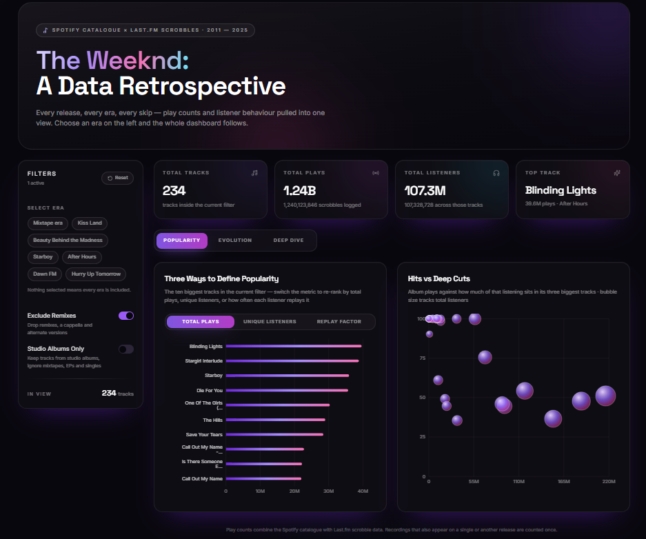
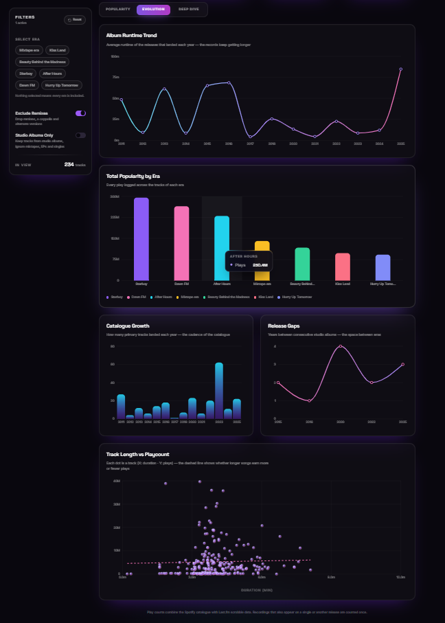
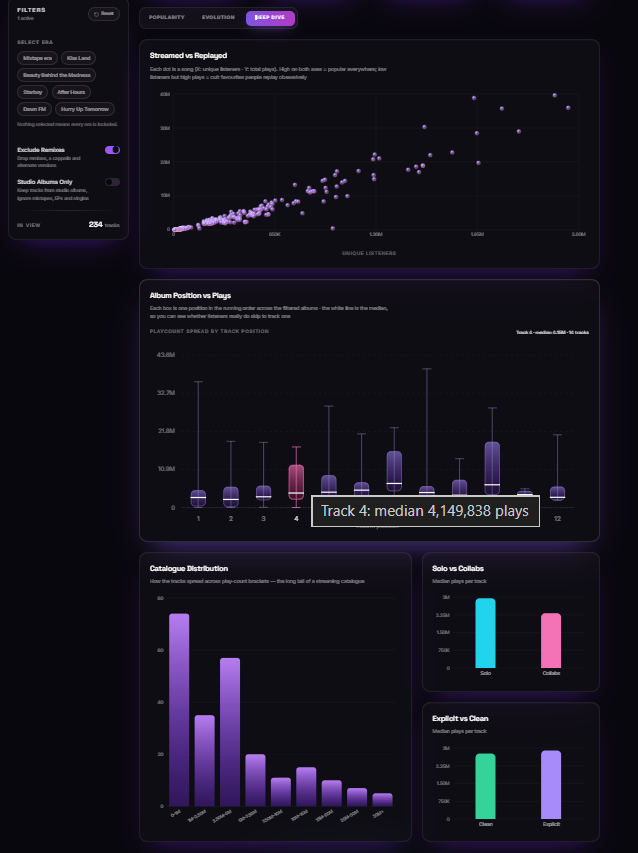

# 🎵 The Weeknd — Spotify & Last.fm Data Analysis

**An end-to-end music data analytics project combining API-based data collection, Python data processing, exploratory data analysis, and an interactive dashboard.**

[](https://weekndanalyticspro.base44.app/)

## 📌 Overview

This project explores the musical catalogue and listening performance of **The Weeknd** by combining music metadata from Spotify with listening statistics from Last.fm.

What started as a personal passion for music became an opportunity to apply data science techniques to a real-world dataset. The project involves collecting music data, processing and validating records, generating analytical datasets, and translating the findings into visualisations and an interactive web dashboard.

The goal is to understand how The Weeknd's discography has evolved over time, how listening engagement differs across tracks and albums, and what patterns emerge from his releases, collaborations, and music characteristics.

## 📊 Dashboard Preview

Explore the different analytical views of The Weeknd's discography through the interactive dashboard.

### 1. Popularity & Listening Performance

Explore track popularity, listener engagement, and the distribution of plays across albums.



### 2. Discography Evolution

Analyse album runtime trends, release gaps, catalogue growth, and the relationship between track duration and playcount.



### 3. Listening Behaviour Deep Dive

Investigate the relationship between plays and listeners, track popularity by album position, catalogue distribution, and performance differences between solo and collaborative tracks.



**[🚀 Launch The Weeknd Analytics Pro](https://weekndanalyticspro.base44.app/)**

## 🎯 Project Objectives

- Build a structured dataset of The Weeknd's releases and tracks.
- Combine Spotify music metadata with Last.fm listening statistics.
- Analyse track popularity, listener engagement, and album performance.
- Investigate release patterns, track durations, explicit content, and collaborations.
- Develop additional metrics to uncover patterns beyond basic summary statistics.
- Communicate insights through data visualisations and an interactive dashboard.

## 🛠️ Tech Stack

| Technology | Application |
|---|---|
| Python | Data collection, transformation, analysis, and chart generation |
| Spotify API | Music metadata and track information |
| Last.fm API | Track playcounts and listener statistics |
| Pandas | Data manipulation and dataset preparation |
| Data visualisation libraries | Generating charts and analytical visuals |
| HTML | Web interface and dashboard presentation |
| Base44 | Building and deploying the interactive web application |
| CSV | Storing processed and analytical datasets |
| Git & GitHub | Version control and project documentation |

## 🔄 Data Pipeline

The project follows a data workflow that moves from collecting music data to preparing analytical datasets and presenting insights.

1. **Data collection:** Retrieve available music metadata and listening statistics from Spotify and Last.fm.
2. **Data preparation:** Organise releases and tracks into structured datasets.
3. **Data validation and enrichment:** Audit track records, reconcile identifiers where possible, and prepare additional metadata.
4. **Dataset construction:** Generate track-level, album-level, and collaborator summary datasets.
5. **Exploratory data analysis:** Investigate trends and relationships across tracks, albums, and release periods.
6. **Data visualisation:** Generate charts to communicate analytical findings.
7. **Dashboard deployment:** Present the results through an interactive web application.

### Key Repository Files

| File or directory | Purpose |
|---|---|
| `spotify_analysis.py` | Spotify-focused analysis |
| `spotify_analysis_offline.py` | Offline analysis using locally available data |
| `collect_weeknd_lastfm_v2.py` | Last.fm data collection |
| `collect_weeknd_lastfm_corrected.py` | Revised Last.fm collection workflow |
| `build_analysis_dataset.py` | Building analysis-ready datasets |
| `fetch_isrc_only.py` | Retrieving ISRC-related track identifiers |
| `merge_isrc.py` | Merging ISRC information into datasets |
| `make_charts.py` and related scripts | Generating analytical charts |
| `app.py` | Application entry point |
| `requirements.txt` | Python dependencies |
| `weeknd_tracks_audited_final.csv` | Audited track dataset |
| `weeknd_tracks_audited_final_with_isrc.csv` | Track dataset with ISRC-related information |
| `weeknd_album_summary.csv` | Album-level summary data |
| `weeknd_collaborator_summary.csv` | Collaborator summary data |
| `weeknd_lastfm_track_matches_v5.csv` | Last.fm track-matching dataset |

*File purposes are based on the repository structure and filenames. Refer to individual scripts for their exact implementation.*

## 📈 Analytical Areas

### 1. Discography & Release Trends

- Number of releases across different years.
- Track counts and album sizes.
- Release frequency and gaps between releases.
- Changes in average track duration over time.
- Album runtime trends.

### 2. Track Popularity & Listening Behaviour

- Most-played tracks based on available Last.fm playcount data.
- Comparisons between playcounts and listener counts.
- Replay factor using plays relative to listeners.
- Most-played tracks within individual albums.
- Explicit tracks as a proportion of the catalogue.

### 3. Album Performance

- Comparison of album-level listening engagement.
- Most popular albums according to selected listening metrics.
- Estimated listening time based on track durations and playcounts.
- Concentration of plays among an album's most popular tracks.
- Identification of potential hits and less-played album tracks.

### 4. Collaborations & Featured Artists

- Collaborators appearing across The Weeknd's discography.
- Solo tracks versus featured tracks.
- Collaboration patterns across different release periods.
- Comparisons of listening performance between solo and collaborative tracks.

### 5. Track Characteristics

- Singles compared with album-only tracks.
- Track title length and naming patterns.
- Common words in song titles.
- Relationships between selected track characteristics and popularity.

## 📐 Metrics & Analytical Methods

Beyond descriptive statistics, the project explores derived metrics to make comparisons more meaningful.

| Metric | Purpose |
|---|---|
| Track count | Measures the size of an album or release |
| Average track duration | Examines changes in song length over time |
| Explicit-track share | Measures the proportion of tracks marked explicit |
| Playcount-to-listener ratio | Provides a rough indicator of repeat listening |
| Estimated listening time | Estimates listening duration using track duration and playcount |
| Top-track play concentration | Examines how much of an album's listening activity is concentrated in its most-played tracks |

Derived metrics depend on the availability and quality of the underlying data. For example, the playcount-to-listener ratio is an aggregate indicator, not a measurement of individual listening behaviour.

## 💡 Key Analytical Questions

The analysis investigates questions such as:

- Which tracks have the highest recorded playcounts?
- Do tracks with more listeners also have higher playcounts?
- Which albums attract the greatest listening engagement?
- How has The Weeknd's release frequency changed throughout his career?
- Are album plays concentrated among a few major hits or distributed across the catalogue?
- How have track duration and album runtime evolved?
- Which collaborators appear most frequently?
- How do solo tracks and featured tracks compare in performance?

## 🖥️ Interactive Web Application

The analysis is presented through **The Weeknd Analytics Pro**, a dedicated web application that brings the project's analytical views together in an interactive format.

The dashboard includes views covering:

- Popularity and track rankings.
- Album runtime and catalogue evolution.
- Release gaps and yearly release patterns.
- Track duration versus playcount.
- Plays versus unique listeners.
- Album track-position performance.
- Catalogue playcount distribution.
- Solo versus collaborative tracks.
- Explicit versus clean tracks.

**[🎧 Explore The Weeknd Analytics Pro](https://weekndanalyticspro.base44.app/)**

## 🚀 Getting Started

### Prerequisites

- Python 3.10 or later, subject to dependency compatibility.
- API credentials for the data sources used by the collection scripts.
- The required Python packages.

### Installation

Clone the repository:

```bash
git clone https://github.com/surapureddyhasini/weeknd-spotify-lastfm-analysis.git
cd weeknd-spotify-lastfm-analysis
```

Create a virtual environment:

```bash
python -m venv .venv
```

Activate it on Windows:

```bash
.venv\Scripts\activate
```

Install the dependencies:

```bash
pip install -r requirements.txt
```

Configure the API credentials required by the relevant scripts. Do not commit API keys or other secrets to GitHub.

Before running the pipeline, review the individual scripts and their input requirements to determine the correct execution order.

## ⚠️ Data Considerations & Limitations

- Spotify and Last.fm provide different types of music and listening metrics.
- Last.fm playcounts and listener counts should not be interpreted as Spotify stream counts or unique Spotify listeners.
- Track matching and metadata availability may vary between sources.
- Missing identifiers and inconsistent track metadata can affect dataset joins and coverage.
- Estimated listening time is a derived approximation, not a measure of verified listening duration.
- Results depend on the available data and the definitions used for each metric.

These limitations should be considered when interpreting the visualisations and drawing conclusions.

## 🌱 Future Improvements

- Automate dataset refreshes and improve API error handling.
- Strengthen track matching, metadata coverage, and data validation.
- Introduce reproducible pipeline execution and automated data quality checks.
- Expand comparative analysis across albums and release periods.
- Improve dashboard filtering and track-level exploration.
- Document key analytical findings with supporting visualisations.

## 👨‍💻 About This Project

This is an independent passion project built to develop my practical skills in **data science, data engineering, and analytical storytelling**.

It combines my interest in music with hands-on experience in API-based data collection, Python data processing, dataset construction, exploratory data analysis, visualisation, and dashboard deployment.

The project demonstrates how a personal interest can be transformed into a structured analytics workflow, from collecting and preparing data to investigating patterns and communicating insights through an interactive web application.

**Live Dashboard:** [The Weeknd Analytics Pro](https://weekndanalyticspro.base44.app/)

---

*This project is intended for educational and analytical purposes. All metrics and conclusions are subject to the availability and limitations of the underlying data sources.*
